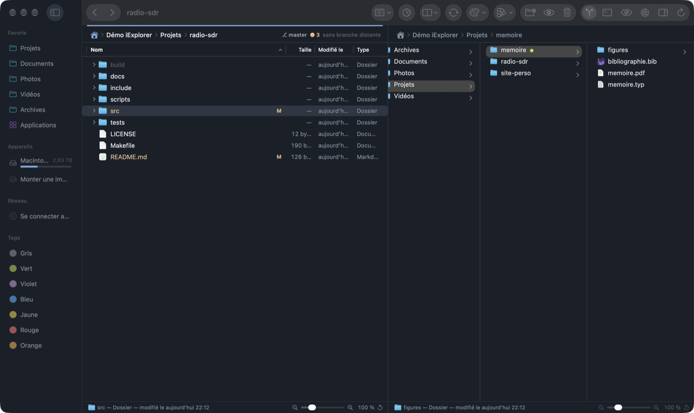
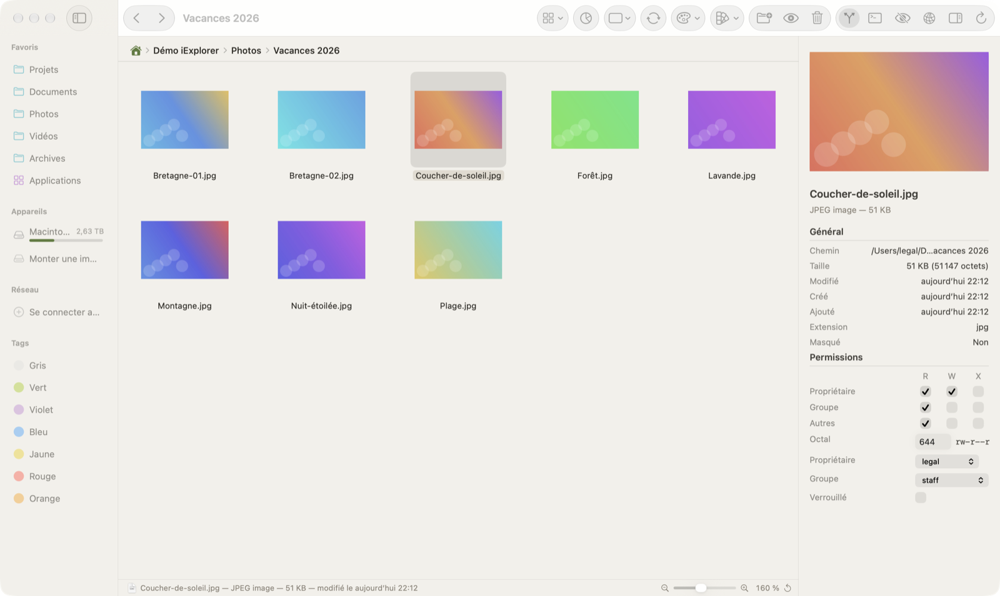
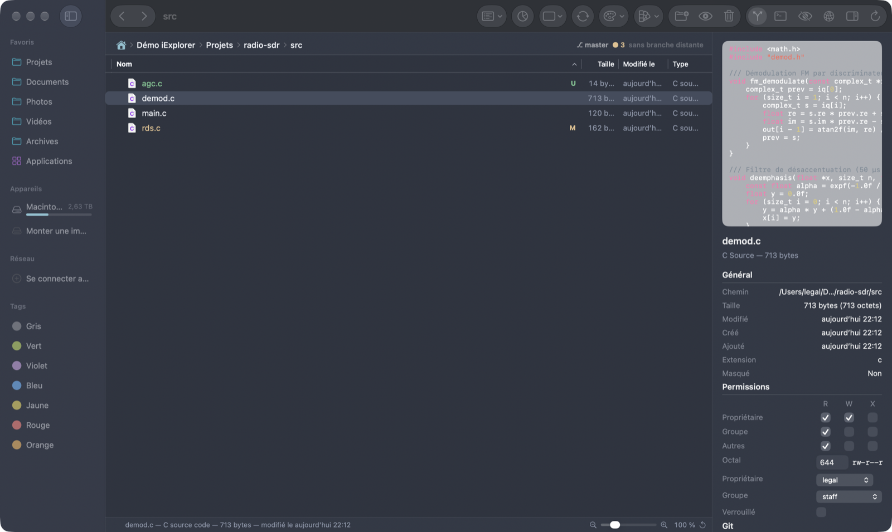
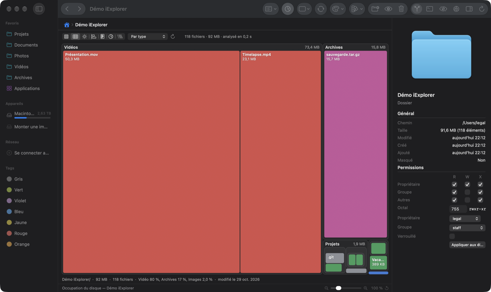
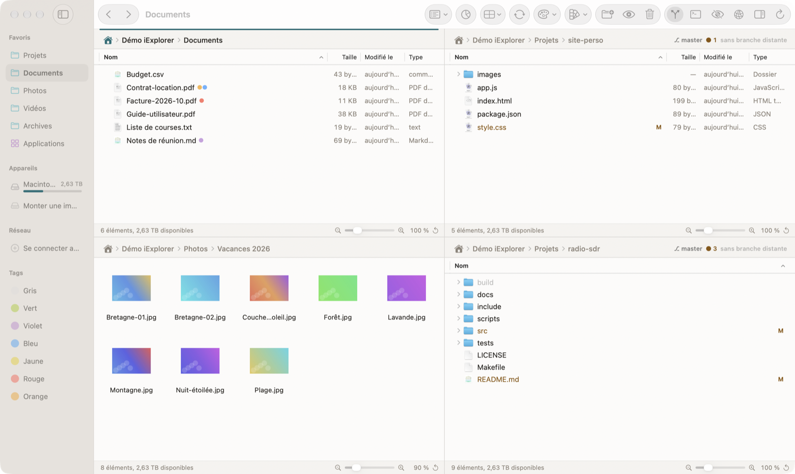

# iExplorer

**Gestionnaire de fichiers natif pour macOS** : jusqu’à quatre panneaux avec onglets, état Git, terminal intégré,
serveurs distants, analyse de l’espace disque et thèmes. Écrit en Swift / AppKit, sans Electron.



## Fonctionnalités

**Navigation**
- 1, 2, 3 ou 4 panneaux (8 dispositions), chacun avec ses onglets colorés et sa barre d’état (sélection, zoom).
- Vues icônes, liste, détails et colonnes ; regroupement par type, date ou taille ; vue à plat de toute une arborescence.
- Navigation synchronisée entre panneaux, comparaison et synchronisation de dossiers, recherche (nom, contenu, tags).
- Archives (zip, tar.gz, 7z, rar…) parcourues comme des dossiers.

**Fichiers**
- Copies et déplacements en arrière-plan, avec débit, pause et vérification facultative des copies.
- Renommage par lot, tags du Finder, nouveaux documents à partir de modèles, partage, annulation (⌘Z).
- Inspecteur : aperçu du code avec coloration, PDF, images, vidéo et son, permissions (R/W/X, octal, propriétaire).

**Pour les développeurs**
- État Git dans les listes, comme dans VS Code ; indexer, valider, tirer et pousser depuis l’inspecteur.
- Terminal intégré qui suit le dossier du panneau actif.
- Actions personnalisées et actions par type de fichier (cibles d’un Makefile, compiler un .typ, convertir un .md…).
- Serveurs SFTP, SMB, AFP, NFS et WebDAV.

**Apparence**
- 12 thèmes de couleurs, chacun en clair et en sombre ; apparence automatique, claire ou sombre.
- 10 thèmes d’icônes de fichiers.

**Espace disque**
- Occupation du dossier courant (⌘5) en 7 graphiques : cartes, soleil, histogramme, liste façon Baobab.

| | |
|---|---|
|  |  |
|  |  |

## Installation

Nécessite **macOS 26** ou plus récent.

1. Téléchargez `iExplorer-x.y.z.dmg` depuis la page [Releases](https://github.com/blegal/EnhancedFileManager/releases/latest).
2. Ouvrez l’image disque et glissez **iExplorer** dans **Applications**.
3. L’app n’est pas notarisée par Apple : au premier lancement, faites **clic droit › Ouvrir**, puis confirmez.
   Vous pouvez aussi retirer l’attribut de quarantaine :

   ```bash
   xattr -dr com.apple.quarantine /Applications/iExplorer.app
   ```

Les mises à jour sont ensuite automatiques. L’app vérifie les nouvelles versions au lancement, ou à la demande avec
**iExplorer › Rechercher les mises à jour…**. Chaque image disque est signée (Ed25519) et vérifiée avant d’être installée.

### Compiler depuis les sources

Il faut Xcode avec Swift 6.

```bash
git clone https://github.com/blegal/EnhancedFileManager.git
cd EnhancedFileManager
./build.sh
open build/iExplorer.app
```

## Raccourcis essentiels

| Action | Raccourci |
|---|---|
| Panneau suivant | ⇥ |
| Copier / déplacer vers l’autre panneau | F5 / F6 |
| Renommer | F2 |
| Coup d’œil | Espace |
| Icônes, liste, détails, colonnes | ⌘1 … ⌘4 |
| Occupation du disque | ⌘5 |
| 1 à 4 panneaux | ⌥⌘1 … ⌥⌘4 |
| Rechercher | ⌘F |
| Se connecter à un serveur | ⌘K |
| Terminal intégré | ⌃\` |

## En savoir plus

Le [guide détaillé](docs/GUIDE.md) décrit toutes les fonctionnalités et la liste complète des raccourcis. Il explique
aussi le format des actions par type de fichier, la publication des versions et la signature des mises à jour.

L’analyse de l’espace disque et la mise à jour automatique sont partagées avec
[iBaobab](https://github.com/blegal/iBaobab), l’analyseur d’occupation des disques.
